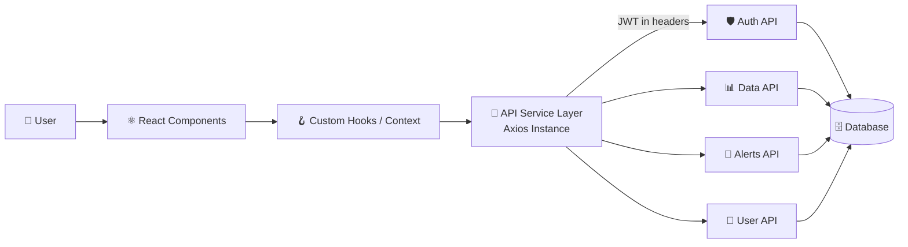

<div align="center">

# 🌍 EnvoSphere — Frontend

**A modern, responsive web client for monitoring, understanding, and acting on environmental data.**


[Features](#-features) •
[Architecture](#-architecture) •
[API Integration](#-api-integration) •
[Getting Started](#-getting-started) •
[Project Structure](#-project-structure) •
[Contributing](#-contributing)

</div>

---

## 📖 Overview

The **EnvoSphere frontend** is the user-facing layer of the EnvoSphere platform. It talks to a set of connected backend services over REST APIs, so every screen — dashboard, analytics, alerts, maps, and user profile — renders **live data** instead of static mock content.

Everything the user sees flows through one pipeline:

```
User Action → React UI → API Service Layer → Backend APIs → Database → Response → UI Update
```

---

## ✨ Features

| | Feature | Description |
|---|---|---|
| 🔐 | **Authentication** | Register, login, logout, and persistent sessions with JWT |
| 📊 | **Live Dashboard** | Real-time environmental metrics pulled from the backend |
| 📈 | **Analytics & Charts** | Trends, comparisons, and historical data visualisation |
| 🗺️ | **Interactive Maps** | Location-based environmental data and markers |
| 🔔 | **Alerts & Notifications** | Instant alerts for threshold breaches and important events |
| 👤 | **User Profile** | View and update account details and preferences |
| 🌗 | **Light / Dark Mode** | Theme toggle with saved preference |
| 📱 | **Fully Responsive** | Optimised for mobile, tablet, and desktop |
| ⚡ | **Fast & Lightweight** | Vite-powered dev server and optimised production builds |

---

## 🏗️ Architecture

All backend communication goes through a single, centralised API layer. Components never call `fetch` or `axios` directly.



**Key design decisions**

- **Single Axios instance** with a request interceptor (attaches the JWT) and a response interceptor (handles `401` globally and redirects to login).
- **Service modules per domain** (`authService`, `dataService`, `alertService`, `userService`) keep API logic out of components.
- **Context + custom hooks** manage auth state and shared data across the app.
- **Protected routes** block unauthenticated users from private pages.

---

## 🔌 API Integration

The frontend is wired to the following backend endpoints. All requests go through the base URL set in `VITE_API_BASE_URL`.

### 🔐 Auth

| Method | Endpoint | Purpose |
|:---:|---|---|
| `POST` | `/api/auth/register` | Create a new account |
| `POST` | `/api/auth/login` | Log in and receive a JWT |
| `POST` | `/api/auth/logout` | End the current session |
| `GET` | `/api/auth/me` | Fetch the logged-in user |

### 📊 Environmental Data

| Method | Endpoint | Purpose |
|:---:|---|---|
| `GET` | `/api/data/current` | Latest readings for the dashboard |
| `GET` | `/api/data/history` | Historical data for charts |
| `GET` | `/api/data/locations` | Locations and map markers |
| `GET` | `/api/data/summary` | Aggregated stats and insights |

### 🔔 Alerts

| Method | Endpoint | Purpose |
|:---:|---|---|
| `GET` | `/api/alerts` | List all alerts |
| `PATCH` | `/api/alerts/:id/read` | Mark an alert as read |
| `DELETE` | `/api/alerts/:id` | Dismiss an alert |

### 👤 User

| Method | Endpoint | Purpose |
|:---:|---|---|
| `GET` | `/api/users/profile` | Get profile details |
| `PUT` | `/api/users/profile` | Update profile details |
| `PUT` | `/api/users/preferences` | Save user preferences |

### Example: API service layer

```js
// src/services/api.js
import axios from "axios";

const api = axios.create({
  baseURL: import.meta.env.VITE_API_BASE_URL,
  timeout: 10000,
});

// Attach JWT to every request
api.interceptors.request.use((config) => {
  const token = localStorage.getItem("token");
  if (token) config.headers.Authorization = `Bearer ${token}`;
  return config;
});

// Global session-expiry handling
api.interceptors.response.use(
  (res) => res,
  (err) => {
    if (err.response?.status === 401) {
      localStorage.removeItem("token");
      window.location.href = "/login";
    }
    return Promise.reject(err);
  }
);

export default api;
```

---

## 🛠️ Tech Stack

| Category | Technology |
|---|---|
| **Framework** | React 18 |
| **Build Tool** | Vite |
| **Styling** | Tailwind CSS |
| **Routing** | React Router |
| **HTTP Client** | Axios |
| **State** | React Context API + custom hooks |
| **Charts** | Recharts / Chart.js |
| **Maps** | Leaflet |
| **Icons** | Lucide React |

---

## 🚀 Getting Started

### Prerequisites

- **Node.js** v18 or higher
- **npm** v9+ (or yarn / pnpm)
- The **EnvoSphere backend** running locally or deployed

### 1. Clone the repository

```bash
git clone https://github.com/anuragsinghofficial2611/EnvoSphere.git
cd EnvoSphere/frontend
```

### 2. Install dependencies

```bash
npm install
```

### 3. Configure environment variables

Create a `.env` file in the `frontend` folder:

```env
VITE_API_BASE_URL=http://localhost:5000
```

### 4. Start the development server

```bash
npm run dev
```

The app runs at **http://localhost:5173**.

### 5. Build for production

```bash
npm run build
npm run preview
```

---

## 📜 Available Scripts

| Command | Description |
|---|---|
| `npm run dev` | Start the development server with hot reload |
| `npm run build` | Create an optimised production build in `dist/` |
| `npm run preview` | Preview the production build locally |
| `npm run lint` | Run ESLint across the project |

---

## 🔑 Environment Variables

| Variable | Required | Description | Example |
|---|:---:|---|---|
| `VITE_API_BASE_URL` | ✅ | Base URL of the backend API | `http://localhost:5000` |

> ⚠️ Never commit your `.env` file. Only variables prefixed with `VITE_` are exposed to the browser, so never place secrets in them.

---

## 📁 Project Structure

```
frontend/
├── public/                  # Static assets
├── src/
│   ├── assets/              # Images, icons, fonts
│   ├── components/          # Reusable UI components
│   │   ├── common/          # Buttons, inputs, modals, loaders
│   │   ├── charts/          # Chart components
│   │   └── layout/          # Navbar, sidebar, footer
│   ├── context/             # Auth and theme context providers
│   ├── hooks/               # Custom React hooks
│   ├── pages/               # Route-level pages
│   │   ├── Home
│   │   ├── Login / Register
│   │   ├── Dashboard
│   │   ├── Analytics
│   │   ├── Map
│   │   ├── Alerts
│   │   └── Profile
│   ├── routes/              # Route config and protected routes
│   ├── services/            # API layer (one file per domain)
│   │   ├── api.js           # Axios instance + interceptors
│   │   ├── authService.js
│   │   ├── dataService.js
│   │   ├── alertService.js
│   │   └── userService.js
│   ├── utils/               # Helpers and formatters
│   ├── App.jsx
│   └── main.jsx
├── .env                     # Environment variables (not committed)
├── index.html
├── package.json
├── tailwind.config.js
└── vite.config.js
```

---

## 🔄 Data Flow Example

What happens when a user opens the dashboard:

1. **Route guard** checks for a valid JWT, otherwise redirects to `/login`.
2. **Dashboard page** mounts and calls `dataService.getCurrent()`.
3. **Axios interceptor** attaches the token and sends `GET /api/data/current`.
4. **Backend** validates the token, queries the database, and returns JSON.
5. **UI** shows loading skeletons, then renders cards and charts with the response.
6. **On error**, a toast is shown, and a `401` triggers an automatic logout.

---

## 🧪 Error & Loading Handling

- ⏳ **Loading states** with skeletons or spinners on every data-driven view
- ❌ **Error states** with a clear message and a retry button
- 📭 **Empty states** when an API returns no data
- 🔁 **Global handling** of expired sessions via the Axios interceptor

---

## 🌐 Deployment

The frontend builds to static files and can be hosted anywhere.

| Platform | Steps |
|---|---|
| **Vercel** | Import the repo, set root to `frontend`, add `VITE_API_BASE_URL`, deploy |
| **Netlify** | Build command `npm run build`, publish directory `dist`, add env variable |
| **GitHub Pages** | Build, then publish the `dist/` folder |

> Remember to add your deployed frontend URL to the backend's CORS allow-list.

---

## 🤝 Contributing

Contributions are welcome!

1. **Fork** the repository
2. **Create** a feature branch: `git checkout -b feature/amazing-feature`
3. **Commit** your changes: `git commit -m "feat: add amazing feature"`
4. **Push** the branch: `git push origin feature/amazing-feature`
5. **Open** a Pull Request

Please follow the existing code style and run `npm run lint` before submitting.

---

## 📄 License

Distributed under the **MIT License**. See `LICENSE` for details.

---

<div align="center">

**Built with 💚 for a greener planet**

⭐ If you like this project, give it a star!

</div>
