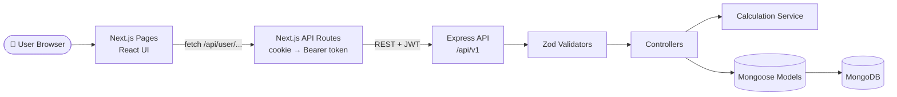

<div align="center">

# 🌍 EnvoSphere

### Measure the real environmental cost of your GPU workloads.

Estimate **energy use, CO₂ emissions, water consumption and heat output** for AI infrastructure — and keep a personal history of every calculation.


[Overview](#-overview) •
[Features](#-features) •
[Tech Stack](#-tech-stack) •
[Architecture](#-architecture) •
[Getting Started](#-getting-started) •
[API Reference](#-api-reference) •
[Methodology](#-calculation-methodology)

</div>

---

## 📖 Overview

AI workloads run on power-hungry GPUs, and the environmental footprint of that compute is rarely visible to the people running it. **EnvoSphere** makes it visible.

You describe a workload — which GPU, how many, for how long, in what kind of facility, powered by how much renewable energy — and EnvoSphere turns it into clear, comparable numbers:

| 🔌 Energy | 🏭 Carbon | 💧 Water | 🔥 Heat |
| :---: | :---: | :---: | :---: |
| IT and total facility energy (kWh) | CO₂ emitted from grid energy (kg) | Cooling water consumed (litres) | Thermal output (kW and BTU/h) |

Every calculation is stored together with the **inputs and assumptions** that produced it, so results are transparent, reproducible and easy to revisit.

> **Who is it for?** Students, researchers, ML engineers and data-center teams who want a quick, understandable estimate of what their GPU compute costs the planet.

---

## ✨ Features

- 🧮 **Environmental impact calculator** — enter GPU model, GPU count, hours used, facility area, renewable-energy share, PUE and WUE
- 📊 **Personal dashboard** — aggregated totals for emissions, energy, water and heat across all your calculations
- 🗂️ **Calculation history** — browse, search and inspect every past calculation with its full breakdown
- 🔐 **Secure authentication** — registration and login with bcrypt-hashed passwords and JWT sessions
- 🍪 **HttpOnly cookie sessions** — the token is never exposed to browser JavaScript
- 👤 **Per-user data isolation** — you can only ever read or delete your own data
- ✅ **Schema validation** — every request body is validated with Zod before it touches business logic
- 📱 **Responsive UI** — clean, accessible interface with a collapsible sidebar on mobile
- 🧱 **Layered backend** — routes → validators → controllers → services → models

---

## 🛠 Tech Stack

### Frontend

| Technology | Purpose |
| --- | --- |
| **Next.js 16** (App Router) | Framework, routing and server-side API proxy routes |
| **React 19** + **TypeScript** | UI and type safety |
| **Tailwind CSS 4** | Styling |
| **Lucide React** | Icons |

### Backend

| Technology | Purpose |
| --- | --- |
| **Node.js** + **Express 5** | REST API |
| **MongoDB** + **Mongoose 9** | Data storage |
| **JSON Web Tokens** + **bcrypt** | Authentication and password hashing |
| **Zod 4** | Request validation |
| **dotenv**, **cors** | Configuration and cross-origin access |

---

## 🏗 Architecture

EnvoSphere is a two-part application. The Next.js frontend never exposes the backend token to the browser — its own API routes act as a thin, authenticated proxy in front of the Express API.



**How a calculation flows through the system**

1. The user submits the calculator form.
2. The Next.js API route reads the `token` HttpOnly cookie and forwards the request to Express with an `Authorization: Bearer` header.
3. Express validates the body with Zod and verifies the JWT.
4. The calculation service computes energy, CO₂, water and heat from the inputs and fixed assumptions.
5. The inputs, assumptions and results are saved to MongoDB under the user's ID and returned to the UI.

---

## 📂 Project Structure

```text
EnvoSphere/
├── frontend/                          # Next.js application
│   ├── app/
│   │   ├── page.tsx                   # Public landing page
│   │   ├── auth/
│   │   │   ├── login/page.tsx
│   │   │   └── register/page.tsx
│   │   ├── user/                      # Authenticated area (sidebar layout)
│   │   │   ├── dashboard/page.tsx
│   │   │   ├── calculator/page.tsx
│   │   │   ├── calculations/page.tsx
│   │   │   ├── comparisons/page.tsx
│   │   │   └── profile/page.tsx
│   │   └── api/                       # Server-side proxy to the Express API
│   │       ├── auth/{login,register}/route.ts
│   │       └── user/
│   │           ├── dashboard/route.ts
│   │           ├── profile/route.ts
│   │           └── calculation/{create,calculations}/route.ts
│   ├── component/
│   │   ├── public/main.tsx            # Landing page
│   │   ├── auth/                      # Login and register forms
│   │   └── user/                      # Sidebar, dashboard, calculator, history, profile
│   └── package.json
│
└── backend/                           # Express REST API
    ├── src/
    │   ├── config/                    # Database connection, env config
    │   ├── constants/                 # GPU and environmental reference data
    │   ├── controllers/               # auth, calculation, dashboard, user
    │   ├── middlewares/               # JWT auth, validation, error handling
    │   ├── models/                    # User and Calculation schemas
    │   ├── routes/                    # auth, calculation, user routes
    │   ├── services/                  # Calculation engine (formulas)
    │   ├── utils/                     # ApiError, asyncHandler
    │   ├── validators/                # Zod schemas
    │   ├── app.js                     # Express app setup
    │   └── server.js                  # Entry point
    ├── tests/                         # unit/ and integration/
    ├── .env.example
    └── package.json
```

---

## 🚀 Getting Started

### Prerequisites

- [Node.js](https://nodejs.org/) **v20+**
- npm (bundled with Node.js)
- [MongoDB](https://www.mongodb.com/) — a local instance or a free [MongoDB Atlas](https://www.mongodb.com/atlas) cluster

### 1. Clone the repository

```bash
git clone https://github.com/<your-username>/EnvoSphere.git
cd EnvoSphere
```

### 2. Set up the backend

```bash
cd backend
npm install
cp .env.example .env      # then fill in the values below
npm run dev
```

`backend/.env`

```env
PORT=5000
MONGO_URI=mongodb://localhost:27017/envosphere
JWT_SECRET=replace_with_a_long_random_string
FRONTEND_URL=http://localhost:3000
```

The API starts at **http://localhost:5000**.

### 3. Set up the frontend

Open a second terminal:

```bash
cd frontend
npm install
npm run dev
```

`frontend/.env.local`

```env
API_URL=http://localhost:5000
NEXT_PUBLIC_API_URL=http://localhost:5000
```

The app starts at **http://localhost:3000**.

### 4. Use it

1. Open `http://localhost:3000` and click **Get started** to create an account.
2. Sign in and open the **Calculator**.
3. Submit a workload and watch your **Dashboard** totals update.

### Environment variables

| Variable | Where | Required | Description |
| --- | --- | :---: | --- |
| `PORT` | backend | No | API port (defaults to `3000`; use `5000` locally to avoid clashing with Next.js) |
| `MONGO_URI` | backend | ✅ | MongoDB connection string |
| `JWT_SECRET` | backend | ✅ | Secret for signing and verifying JWTs |
| `FRONTEND_URL` | backend | ✅ | Allowed CORS origin |
| `API_URL` | frontend | ✅ | Base URL of the Express API, used by Next.js API routes |
| `NEXT_PUBLIC_API_URL` | frontend | ✅ | Base URL of the Express API, used from the browser |

> ⚠️ Never commit `.env` files. Generate a strong secret with:
> `node -e "console.log(require('crypto').randomBytes(64).toString('hex'))"`

### Scripts

| Location | Command | Description |
| --- | --- | --- |
| `backend/` | `npm run dev` | Start the API with auto-reload (nodemon) |
| `backend/` | `npm start` | Start the API in production mode |
| `frontend/` | `npm run dev` | Start the Next.js dev server |
| `frontend/` | `npm run build` | Create a production build |
| `frontend/` | `npm start` | Serve the production build |
| `frontend/` | `npm run lint` | Lint with ESLint |

---

## 📡 API Reference

**Base URL:** `http://localhost:5000/api/v1`

Protected routes (🔒) require:

```http
Authorization: Bearer <jwt>
```

| Method | Endpoint | Auth | Description |
| :---: | --- | :---: | --- |
| `POST` | `/auth/register` | — | Create an account |
| `POST` | `/auth/login` | — | Log in and receive a JWT (valid for 1 day) |
| `GET` | `/user/get` | 🔒 | Get the current user's profile |
| `POST` | `/calculation/create` | 🔒 | Run and save a calculation |
| `GET` | `/calculation/getall` | 🔒 | List all of the user's calculations (newest first) |
| `GET` | `/calculation/get/:id` | 🔒 | Get one calculation |
| `DELETE` | `/calculation/delete/:id` | 🔒 | Delete one calculation |
| `GET` | `/calculation/dashboard` | 🔒 | Aggregated totals and averages |

<details>
<summary><b>📝 Register — <code>POST /auth/register</code></b></summary>

```json
{
  "username": "eco_dev",
  "email": "eco@example.com",
  "password": "StrongPass123"
}
```

| Field | Rules |
| --- | --- |
| `username` | 3–15 characters; letters, numbers and underscores |
| `email` | Valid email, stored lowercase |
| `password` | 8–72 characters |

**Responses:** `201` created · `400` validation failed · `409` user already exists

</details>

<details>
<summary><b>🔑 Login — <code>POST /auth/login</code></b></summary>

```json
{ "email": "eco@example.com", "password": "StrongPass123" }
```

```json
{ "success": true, "message": "Login successful", "token": "<jwt>", "id": "665f1c2e..." }
```

**Responses:** `200` success · `401` invalid email or password

</details>

<details>
<summary><b>🧮 Create calculation — <code>POST /calculation/create</code></b></summary>

**Request**

```json
{
  "facilityArea": 120,
  "gpuModel": "NVIDIA H100",
  "gpuCount": 8,
  "hoursUsed": 72,
  "renewableEnergyPercent": 30,
  "pue": 1.4,
  "wue": 1.8
}
```

| Field | Type | Rules |
| --- | --- | --- |
| `facilityArea` | number | > 0 (m²) |
| `gpuModel` | string | One of the [supported GPUs](#supported-gpu-models) |
| `gpuCount` | integer | > 0 |
| `hoursUsed` | number | > 0 |
| `renewableEnergyPercent` | number | 0–100 |
| `pue` | number | ≥ 1 — Power Usage Effectiveness |
| `wue` | number | ≥ 0 — Water Usage Effectiveness (L/kWh) |

**Response — `201 Created`**

```json
{
  "success": true,
  "message": "Environmental impact calculated and saved successfully",
  "data": {
    "inputs": { "...": "as submitted" },
    "assumptions": { "gpuTdpWatts": 700, "carbonIntensityKgPerKwh": 0.72 },
    "results": {
      "gpuPowerWatts": 5600,
      "gpuPowerKw": 5.6,
      "itEnergyKwh": 403.2,
      "facilityEnergyKwh": 564.48,
      "renewableEnergyKwh": 169.344,
      "gridEnergyKwh": 395.136,
      "co2EmissionsKg": 284.4979,
      "heatKw": 5.6,
      "heatBtuPerHour": 19107.9952,
      "waterConsumptionLitres": 725.76,
      "energyIntensityKwhPerM2": 4.704,
      "carbonIntensityKgPerM2": 2.3708
    }
  }
}
```

</details>

<details>
<summary><b>📊 Dashboard summary — <code>GET /calculation/dashboard</code></b></summary>

Returns totals across all of the user's calculations: number of calculations, emissions, water, facility energy, IT energy and heat, plus average PUE and WUE. A user with no calculations receives zeroed values.

</details>

**Error format** — every failure returns the same shape:

```json
{ "success": false, "message": "Human-readable message", "errors": [] }
```

| Status | Meaning |
| :---: | --- |
| `400` | Validation failed |
| `401` | Missing, invalid or expired token |
| `404` | Resource not found |
| `409` | Conflict (e.g. user already exists) |
| `500` | Unexpected server error |

---

## 🧬 Calculation Methodology

All formulas live in [`backend/src/services/calculation.service.js`](backend/src/services/calculation.service.js).

| Metric | Formula |
| --- | --- |
| GPU power (W) | `TDP × gpuCount` |
| IT energy (kWh) | `GPU power (kW) × hoursUsed` |
| Facility energy (kWh) | `IT energy × PUE` |
| Renewable energy (kWh) | `Facility energy × renewable % / 100` |
| Grid energy (kWh) | `Facility energy − Renewable energy` |
| **CO₂ emissions (kg)** | `Grid energy × 0.72` |
| Heat output (kW) | `GPU power (kW)` |
| Heat output (BTU/h) | `GPU power (kW) × 3412.142` |
| **Water use (litres)** | `IT energy × WUE` |
| Energy intensity | `Facility energy / facilityArea` (kWh/m²) |
| Carbon intensity | `CO₂ emissions / facilityArea` (kg/m²) |

**Assumptions:** grid carbon intensity of `0.72 kg CO₂/kWh`, and GPUs running at their rated TDP.

### Supported GPU models

| GPU | TDP (W) |
| --- | ---: |
| NVIDIA H100 | 700 |
| NVIDIA A100 | 400 |
| NVIDIA L40S | 350 |
| NVIDIA RTX 6000 Ada | 300 |
| NVIDIA T4 | 70 |

> ℹ️ Results are **estimates for awareness and comparison**, not certified emissions reporting.

---

## 🗄 Data Models

**User** — `username` (unique), `email` (unique, lowercase), `passwordHash` (bcrypt, never returned), `role` (`user` / `admin`), `isActive`, timestamps.

**Calculation** — `user` (reference, indexed), `inputs`, `assumptions`, `results`, timestamps.

---

## 🔒 Security

- Passwords are hashed with **bcrypt** (10 salt rounds); plain text is never stored
- **JWTs** expire after 1 day
- The session token lives in an **HttpOnly, SameSite=Lax cookie** (`Secure` in production)
- Request bodies are validated with **Zod** before processing
- Calculations are always queried by both `_id` **and** `user`, so one user can never access another's data
- **CORS** is restricted to the configured frontend origin
- Secrets are loaded from environment variables and excluded from version control

---

## 🗺 Roadmap

- [ ] AI-generated summaries and efficiency recommendations
- [ ] Side-by-side comparison of calculations and facilities
- [ ] Editable user profile
- [ ] Automated unit and integration tests
- [ ] Rate limiting and security headers (`express-rate-limit`, `helmet`)
- [ ] OpenAPI / Swagger documentation
- [ ] Docker setup and CI/CD

---

## 🤝 Contributing

Contributions are welcome.

1. Fork the repository
2. Create a branch: `git checkout -b feature/your-feature`
3. Commit: `git commit -m "feat: add your feature"`
4. Push: `git push origin feature/your-feature`
5. Open a Pull Request

Please keep the backend's layered structure (routes → validators → controllers → services → models).

---

## 📄 License

Distributed under the **ISC License**.

<div align="center">

**Smaller footprint. Smarter compute.** 🌱

</div>
